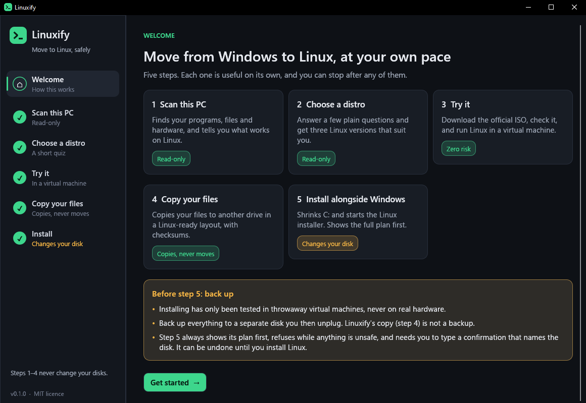
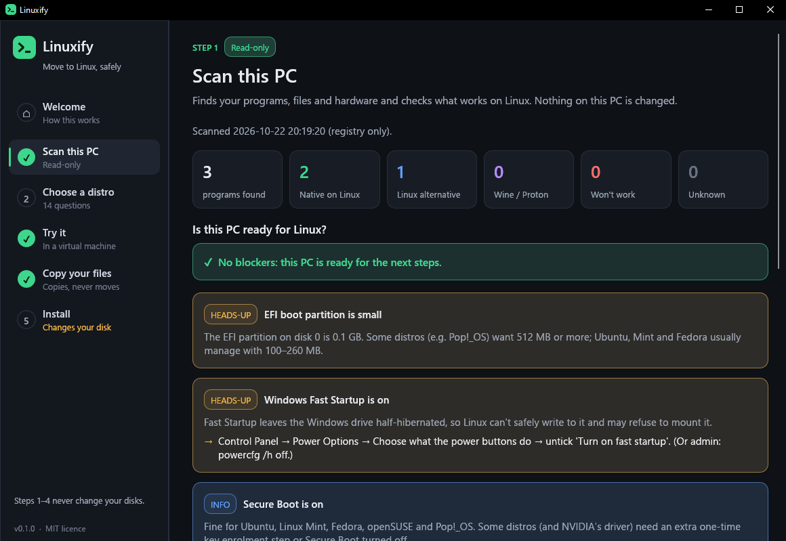
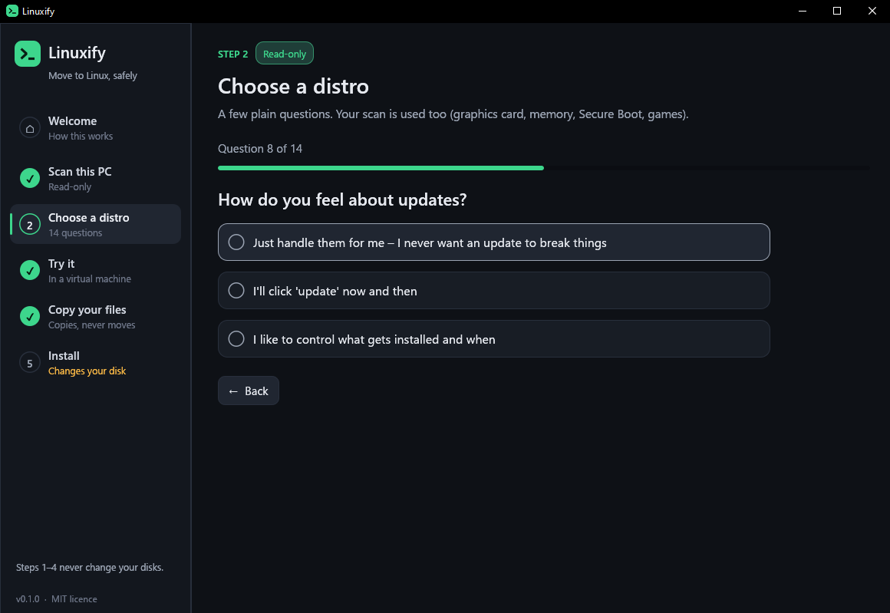
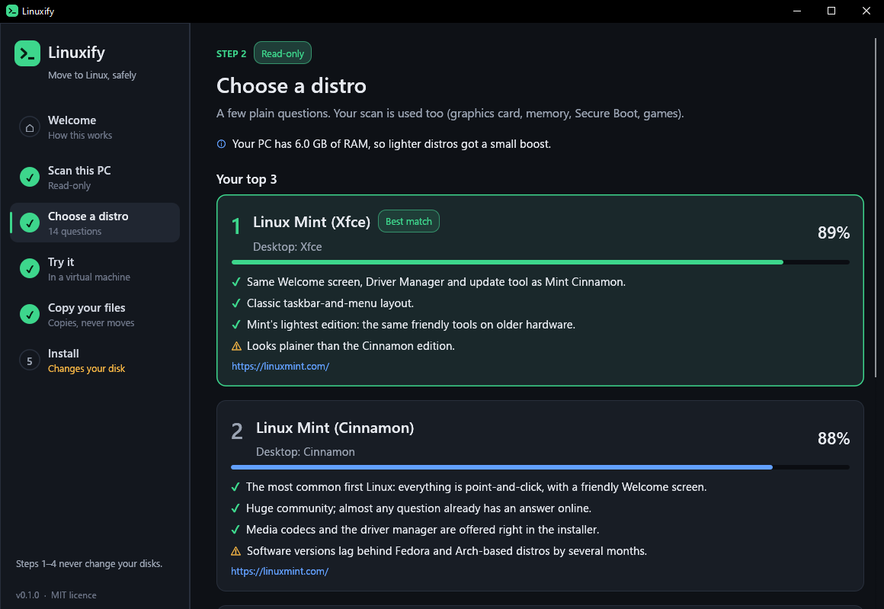
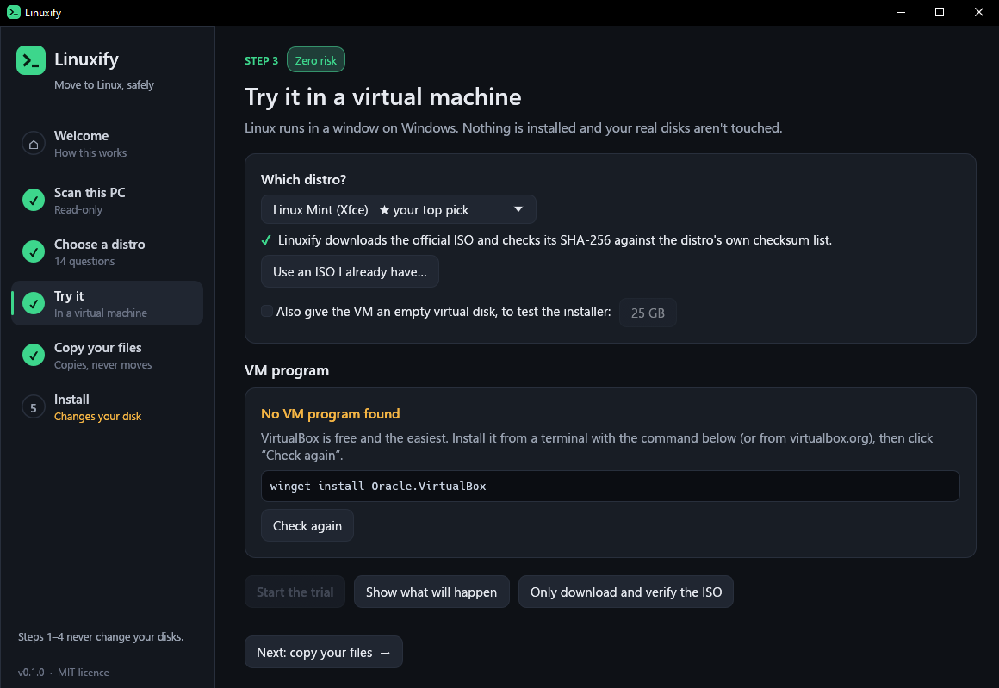
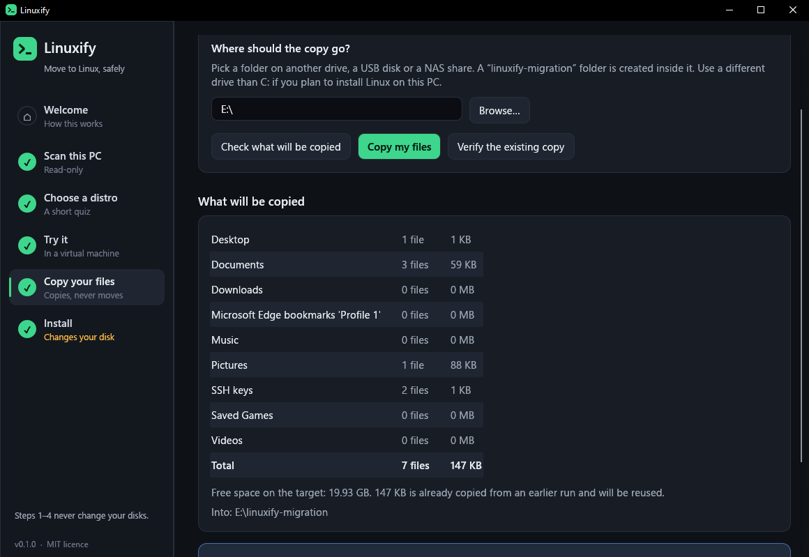
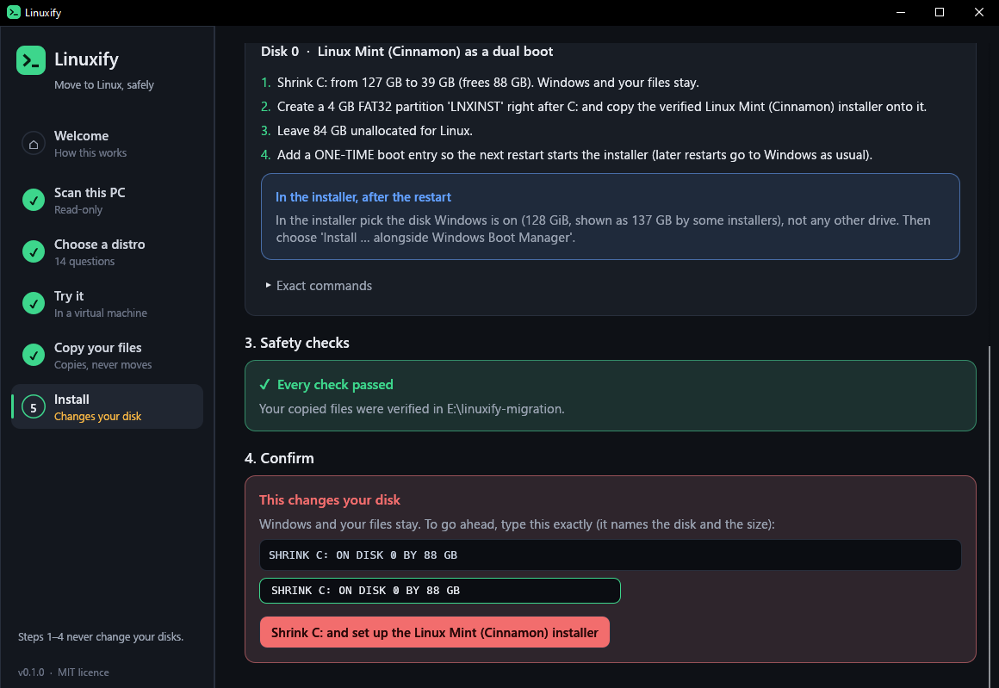
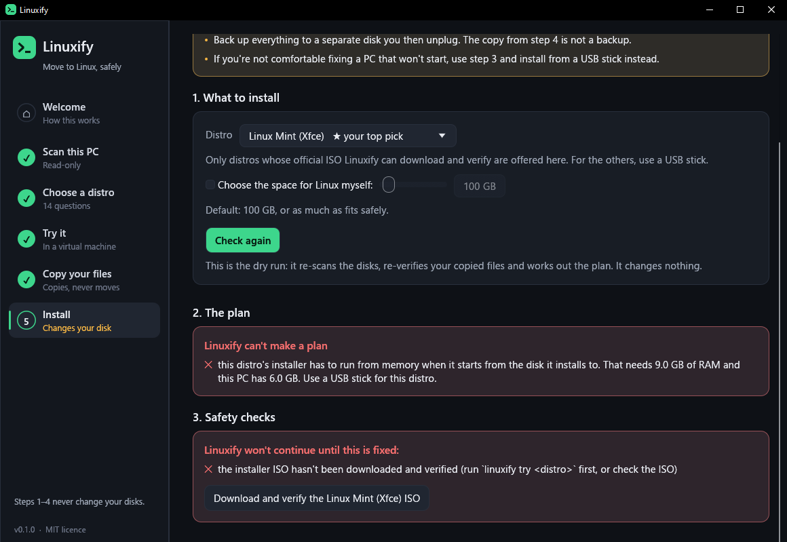
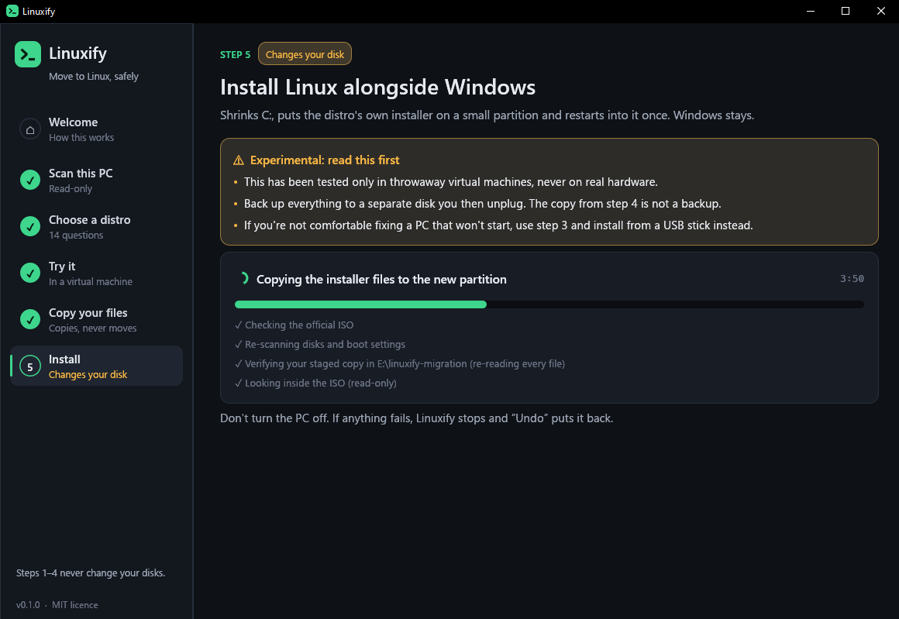
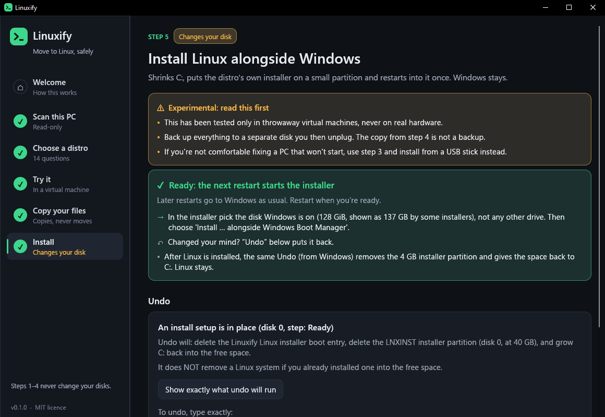

# Linuxify

A Windows program that helps you move to Linux. It scans your PC, recommends a distro, lets you
try it safely, copies your files into a Linux-ready staging folder, and (last, and only with
explicit confirmation) sets up a dual boot.

> ## ⚠️ Safety warning: read this first
>
> `linuxify install` **repartitions your disk**: it shrinks C:, creates a partition and adds a
> boot entry. `remove-windows.sh` **permanently deletes Windows**. These are experimental tools:
>
> - They have been tested **only in throwaway VirtualBox VMs** (Windows 10 22H2, UEFI), once per
>   offered distro. Never on real hardware. See `PROGRESS.md` for exactly what is and isn't
>   tested.
> - **Back up everything first**, to a separate disk you then unplug. Linuxify's own staged copy
>   is not a backup.
> - Always run `--dry-run` first and read the plan. Real runs need a typed confirmation that
>   names the disk.
> - To make a PC permanently refuse any disk change, create an empty file
>   `%LOCALAPPDATA%\Linuxify\no-install.lock`.
>
> No warranty (see `LICENSE`). If you're not comfortable fixing a PC that won't boot, use
> `linuxify try` (a virtual machine, zero risk) and install Linux from a USB stick yourself.

## Download

Get `linuxify.exe` from the [latest release](https://github.com/tiiow-fedora/linuxify/releases/latest)
(Windows 10/11, x64). It's one self-contained file: put it in a folder and double-click it to
open the window, or run it from a terminal (`linuxify scan --open`). It isn't code-signed, so SmartScreen may warn the first time; compare it
with the release's `SHA256SUMS.txt` (`Get-FileHash linuxify.exe`).

## Build

Or build it yourself. Windows 10/11, x64. Install Rust from <https://rustup.rs> (MSVC toolchain), then:

```
cargo build --release
cargo test
```

The result is one self-contained `target\release\linuxify.exe` (the C runtime is linked statically).

## Use

Every stage is useful on its own. Stages 1–4 never change your disks.

### In a window

Double-click `linuxify.exe` (or run `linuxify gui`) and it walks you through the five steps:
scan, a short quiz, a trial in a virtual machine, copying your files, and the install. It runs the
same code as the commands below, with the same safety rules: the install step always shows its
plan first, lists anything that blocks it, and only starts once you type the phrase that names the
disk; it re-checks everything when you click, and offers Undo afterwards. `linuxify gui --page
install` opens a given step (`welcome`, `scan`, `choose`, `try`, `migrate`, `install`).

| | |
|---|---|
|  |  |
|  |  |
|  |  |
|  |  |
|  |  |

### From a terminal

```
linuxify scan --open                    # 1. read-only scan + Linux readiness report (HTML)
linuxify choose --open                  # 2. ~14 questions -> ranked distro picks
linuxify try linux-mint                 # 3. download + SHA-256-verify the ISO, boot it in a VM
linuxify migrate --target E:\ --dry-run # 4. stage your files for Linux (copy, never move)
linuxify migrate --target E:\

linuxify install linux-mint --dry-run   # 5. show the dual-boot plan; changes nothing
linuxify install linux-mint             #    do it (admin, typed confirmation)
linuxify install --undo                 #    remove the installer partitions, grow C: back
```

What `install` does: shrinks C:, puts the distro's own installer on a small FAT32 partition
(`LNXINST`; plus an NTFS `LNXDATA` partition when an Ubuntu-family ISO has a file too big for
FAT32, like Kubuntu's), leaves the rest unallocated, and adds a **one-time** boot entry. Restart, pick
"Install alongside Windows" in the installer, and finish it there. Windows stays.

On the new Linux system, open the `linuxify-migration` folder (on the drive you staged to) in a
terminal:

```
bash restore.sh --dry-run    # show what it would do
bash restore.sh              # copy your files home, set up profiles, install your apps
bash remove-windows.sh       # OPTIONAL, check only: what removing Windows would delete
```

`remove-windows.sh --really` deletes Windows only after re-checking every restored file against
the checksums taken on Windows, and only after you type the confirmation phrase.

## Files

- `PROGRESS.md`: what each stage does, what was verified, and what isn't tested.
- `DECISIONS.md`: design choices and why.
- `data/app_map.json`: Windows programs mapped to Linux equivalents (format in `data/SCHEMA.md`).
  Pull requests welcome.
- `data/distros.json`, `data/isos.json`: distros, quiz traits, official ISO + checksum sources.
- `HANDOFF.md`: the original build brief.

## Licence

MIT. See `LICENSE`.
